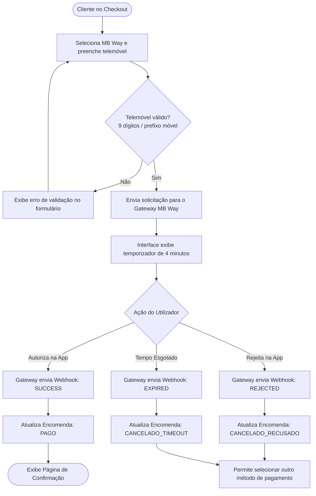
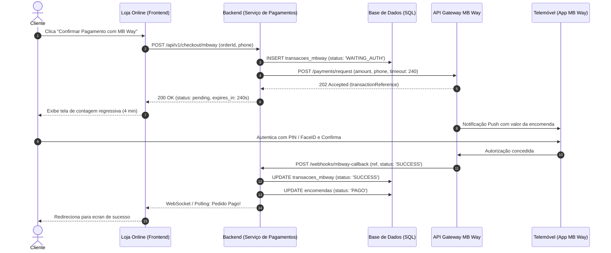

# 📱 Projeto de Análise Funcional & QA: Integração MB Way

Projeto prático desenvolvido para demonstrar competências essenciais de **Analista Funcional** e **Quality Assurance**:
*   Levantamento de Requisitos e Regras de Negócio
*   Modelação de Processos com **BPMN** e **UML**
*   Criação de especificações executáveis com **BDD**, **Gherkin** e **Feature Files**
*   Validação funcional e testes de integridade relacional com **SQL**

---

## 🎯 1. Visão Geral e Requisitos de Negócio

### Contexto
O objetivo é integrar o método de pagamento instantâneo **MB Way** ao fluxo de checkout de uma plataforma de e-commerce que opera em Portugal, reduzindo fricções de abandono de carrinho.

### User Story
> **Como** cliente da loja online em Portugal,  
> **Quero** realizar o pagamento da minha encomenda inserindo apenas o meu número de telemóvel,  
> **Para que** a transação seja concluída rapidamente através da aplicação MB Way no meu dispositivo móvel.

### Regras de Negócio (Business Rules)
*   **RN-01 (Validação de Prefixo e Tamanho):** O número de telemóvel deve ter exatamente 9 dígitos numéricos e iniciar obrigatoriamente por `91`, `92`, `93` ou `96` (operadoras móveis nacionais).
*   **RN-02 (Janela de Confirmação / Timeout):** O cliente dispõe de **4 minutos** (240 segundos) para autorizar a operação na aplicação MB Way. Após esse período, a transação expira automaticamente.
*   **RN-03 (Reserva de Stock):** Os itens permanecem reservados no carrinho durante o período de espera. Caso o pagamento expire ou seja rejeitado, a reserva é libertada.
*   **RN-04 (Idempotência e Conciliação):** O sistema deve registrar o identificador único fornecido pelo gateway para evitar cobranças duplicadas em caso de retransmissão de webhook.

---

## 🗺️ 2. Modelação de Processos de Negócio (BPMN)

O fluxo abaixo representa o ciclo de decisão do utilizador e do sistema durante a jornada de pagamento:

---

## ⚙️ 3. Modelação Técnica (UML - Diagrama de Sequência)

Representação técnica das mensagens trocadas entre os componentes de software, a API externa e a base de dados:

---

## 🥒 4. Especificação Executável (BDD / Gherkin)

Os cenários funcionais foram traduzidos para a linguagem Gherkin, servindo tanto como documentação de negócio quanto como base para automação de testes:

📁 **Arquivo:** [`features/pagamento_mbway.feature`](./features/pagamento_mbway.feature)

*   **Cenário 1:** Pagamento aprovado com sucesso dentro do prazo limite (`@smoke` `@happy_path`)
*   **Cenário 2:** Pagamento cancelado por expiração de tempo limite (`@negativo` `@timeout`)
*   **Cenário 3:** Esquema do Cenário com validações de telemóvel inválido (`@negativo` `@validacao_formulario`)
*   **Cenário 4:** Pagamento rejeitado manualmente pelo utilizador (`@negativo` `@recusa_utilizador`)

---

## 🗄️ 5. Validação Funcional com SQL (Base de Dados)

O papel do Analista Funcional / QA vai além da validação visual. Foram elaborados scripts para validar a integridade dos dados e regras financeiras:

📁 **Arquivo:** [`sql/validacao_integridade_mbway.sql`](./sql/validacao_integridade_mbway.sql)

### Queries Principais:
1.  **Validação de Conciliação Financeira:** Garante que o valor efetivamente debitado pelo gateway coincide centavo a centavo com o total da encomenda.
2.  **Auditoria de Transições de Estado:** Assegura que encomendas expiradas por timeout transitaram para o estado correto.
3.  **Detecção de Inconsistências (Bug Hunter Query):** Localiza anomalias críticas onde encomendas possam ter sido marcadas como `PAGO` sem a confirmação de sucesso do gateway.

---

## 📊 6. Matriz de Rastreabilidade (RTM)

| ID Requisito | Regra de Negócio | Cenário Gherkin (BDD) | Verificação Técnica (SQL) |
| :--- | :--- | :--- | :--- |
| **REQ-01** | Validação de Telemóvel Nacional (RN-01) | *Validação de formato de número de telemóvel inválido* | Validação a nível de API / Constraints |
| **REQ-02** | Janela de Timeout de 4 min (RN-02) | *Pagamento cancelado por expiração de tempo limite* | `sql/validacao_integridade_mbway.sql` (Cenário 2) |
| **REQ-03** | Conciliação e Integridade Financeira (RN-04) | *Pagamento aprovado com sucesso dentro do prazo* | `sql/validacao_integridade_mbway.sql` (Auditoria 1 e 2) |
